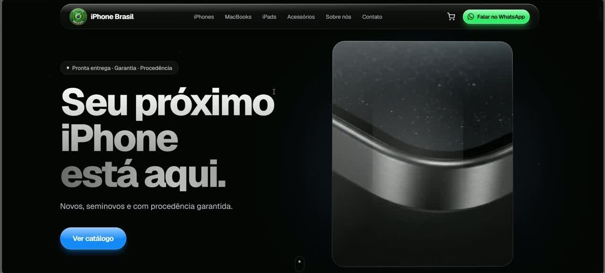

[English](README.md) | **Português**

# Loja de iPhone — modelo white-label (produtos Apple)

Loja online de iPhones, escura, rápida e personalizável, com painel admin. Pensada
como **modelo de loja Apple white-label**: cada cliente troca **paleta, logo,
WhatsApp e produtos** por variáveis de ambiente (ou um único arquivo de config)
e pelo painel. O fechamento da compra é 100% pelo **WhatsApp** (sem gateway de
pagamento).

> **Tipo:** demo comercial / base white-label · **Demo:** <https://loja-de-iphone-demo.vercel.app>
>
> Projeto independente. **Não é afiliado, patrocinado ou endossado pela Apple
> Inc.** "Apple", "iPhone", "iPad", "MacBook", "Apple Watch" e "AirPods" são
> marcas da Apple Inc., usadas apenas para descrever os produtos vendidos por
> revendedores. Nome, logo e contatos da loja de demonstração são fictícios.



## Funcionalidades

- **Vitrine**: hero com vídeo, faixa de confiança, cards por linha (iPhone,
  MacBook, iPad, acessórios), catálogo por linha com preço, parcelamento,
  saúde da bateria e condição; seção de acessórios com filtro.
- **Página do produto** com galeria/lightbox, especificações, disponibilidade
  por unidade e produtos relacionados.
- **Carrinho** (Zustand, persistido no navegador) com **"Finalizar no
  WhatsApp"**: abre a conversa com a mensagem pronta (itens e total).
- **Trade-in**: formulário que monta a mensagem de troca para o WhatsApp.
- **Seções editáveis**: "Nossa loja"/unidades (endereço, horário, mapa,
  WhatsApp por unidade), entregas realizadas, Instagram.
- **Painel admin** (`/admin`): login, recuperação de senha, CRUD de produtos
  com fotos, ativar/desativar, informações da loja, unidades e imagens do site.
- **SEO**: JSON-LD de produto, `sitemap.xml`, `robots.txt`, imagem Open Graph.
- **Modo demo**: sem Supabase configurado, a loja roda com produtos de exemplo.

## Escopo: modelo de **loja Apple**, não white-label genérico

A personalização cobre **marca, identidade visual, contatos, endereços, textos
da vitrine e catálogo** — trocados por loja **sem editar código** (env vars +
admin).

O que é **fixo por design** (assume produtos Apple) e exigiria **código +
migration** para outro nicho:

- **Categorias** — `iphone / macbook / ipad / watch / airpods / accessory` em
  `src/lib/data/types.ts` (`CATEGORIES`) e na coluna `category` (check no banco).
- **Marca no SEO** — o JSON-LD de produto declara `brand: "Apple"` para itens
  que não são acessório (`src/app/(loja)/produtos/[id]/page.tsx`).
- **Rótulos de navegação** ("iPhones", "MacBooks", "Trocar meu iPhone") e
  algumas frases assumem o universo Apple.

Para uma revenda Apple-cêntrica nada disso muda — é só configurar. Para um
nicho diferente, trate como fork e ajuste os 3 pontos acima.

## Stack

- **Next.js 15** (App Router) + **TypeScript** + React 19
- **Tailwind CSS v4** (tema via CSS variables)
- **Framer Motion** (hero animado, micro-interações)
- **Supabase** (`@supabase/ssr`): Auth (dono), Postgres (produtos/estoque/conteúdo), Storage (fotos)
- **Zustand** (carrinho) + **Zod** (validação)

## Pré-requisitos

- Node.js 20+ (testado com Node 22) e npm
- Um projeto Supabase (opcional para ver o modo demo)

## Setup

### 1. Dependências

```bash
npm ci
```

### 2. Projeto no Supabase

Crie um projeto em [supabase.com](https://supabase.com). Em **Project Settings →
API**, copie a **Project URL** e a **anon/publishable key**.

### 3. Variáveis de ambiente

Copie `.env.example` para `.env.local` e preencha (lista completa e comentada
no próprio arquivo):

```
NEXT_PUBLIC_SUPABASE_URL=https://<seu-projeto>.supabase.co
NEXT_PUBLIC_SUPABASE_ANON_KEY=<sua-anon-key>
NEXT_PUBLIC_SITE_URL=
NEXT_PUBLIC_STORE_NAME=
NEXT_PUBLIC_STORE_WHATSAPP=
```

> Este projeto **não usa** a `service_role`. Não a coloque em lugar nenhum.
> Sem as variáveis do Supabase a loja entra em **modo demo**.

### 4. Banco de dados

Aplique **todas** as migrations de `supabase/migrations/` (tabelas, RLS,
bucket, policies, rate limit, trigger de estoque):

```bash
supabase link --project-ref <REF>
supabase db push
```

Sem a CLI, execute os arquivos no SQL Editor **em ordem**. Para dados de
exemplo, rode também `supabase/seed.sql`.

### 5. Usuário do dono

Crie o usuário em **Authentication → Users → Add user**, inclua-o na
allow-list `public.admins` e **desative os signups públicos**. Passo a passo
em [`docs/NOVA-LOJA.md`](docs/NOVA-LOJA.md).

### 6. Rode

```bash
npm run dev
```

- Loja: <http://localhost:3000>
- Admin: <http://localhost:3000/admin>

## Personalizar para um novo cliente

1. **`src/config/theme.config.ts`** — fonte única de nome, descrição, logo,
   WhatsApp, redes e cores. Os valores vêm das variáveis
   `NEXT_PUBLIC_STORE_*` / `NEXT_PUBLIC_COLOR_*` e caem nos defaults da loja
   "iDemo" quando vazias.
2. **`src/config/copy.ts`** (opcional) — títulos, frases e CTAs da vitrine.
3. **Mídias em `/public`** — `logo.svg` (ou `NEXT_PUBLIC_STORE_LOGO_URL`),
   `hero-v5.mp4`, `hero-poster.jpg`, `tradein-v2.webp`.
4. **Produtos e conteúdo** — pelo painel `/admin` ou `supabase/seed.sql`.

**Revenda (1 código, várias lojas):** prefira não editar o `theme.config.ts`
por loja — defina as variáveis de cada loja no deploy. Regra de ouro:
**1 cliente = 1 projeto Supabase + 1 deploy**. Roteiro completo:
[`docs/NOVA-LOJA.md`](docs/NOVA-LOJA.md).

> Como funciona: `theme.config.ts` → `<ThemeInjector>` injeta as cores como
> CSS variables (`--store-*`) no `:root` → o Tailwind (`@theme inline` em
> `globals.css`) gera `bg-bg`, `bg-surface`, `text-primary` etc.

## Estrutura

```
src/
  app/
    (loja)/                # rotas públicas (home, produtos, carrinho)
    admin/                 # login, recuperação de senha e CRUD protegido
  components/              # componentes reutilizáveis (sem queries)
  config/theme.config.ts   # personalização: cores, contatos, redes
  config/copy.ts           # personalização: textos da vitrine
  lib/
    data/                  # ÚNICA camada que fala com o Supabase
    supabase/              # clients (server, client, middleware)
    validation/            # schemas Zod
    auth/                  # helpers de sessão + rate limit
    cart/                  # store do carrinho (Zustand)
supabase/
  migrations/              # schema + RLS + Storage
  seed.sql                 # produtos de exemplo
docs/                      # roteiro de nova loja, postura de segurança, capturas
```

## Convenções

- **Preços em centavos** (inteiro) no banco; `formatCents()` formata só na UI.
- **Nenhum componente** importa o Supabase direto — tudo passa por `lib/data/`.
- **Mutações** só via Server Actions com validação Zod.
- **Texto de marketing** mora em `config/copy.ts`.
- **WhatsApp** sempre normalizado por `lib/phone.ts`; links saem por
  `waUrl()`/`<WhatsappCta>` — nunca monte `wa.me` na mão.

Regenerar os types do banco:

```bash
supabase gen types typescript --project-id <REF> > src/types/database.types.ts
```

## Scripts

```bash
npm run dev     # desenvolvimento
npm run build   # build de produção
npm run start   # servir o build
npm run lint    # eslint
npx tsc --noEmit
```

## Limitações

- Sem gateway de pagamento: a compra é fechada pelo WhatsApp.
- Sem testes automatizados; o CI roda lint, typecheck e build.
- Domínio fixo em produtos Apple (ver "Escopo").
- Não há isolamento multi-tenant no banco: cada loja precisa do próprio projeto Supabase.

## Mídias

Vídeos e imagens de `/public` e o logo da loja de demonstração: origem não
documentada. Troque pelo material do cliente antes de publicar uma loja real.

## Documentação adicional

- [`docs/NOVA-LOJA.md`](docs/NOVA-LOJA.md) — checklist para colocar uma nova loja no ar.
- [`DESCRICAO_PRODUTO.md`](DESCRICAO_PRODUTO.md) — descrição do produto e pitch comercial.

## Segurança

Veja [SECURITY.md](SECURITY.md) para reportar vulnerabilidades e
[docs/SECURITY-POSTURE.md](docs/SECURITY-POSTURE.md) para a postura completa
(RLS, Storage, cookies httpOnly, rate limit, headers).

## Licença

Ainda não há licença definida; todos os direitos reservados ao autor.
